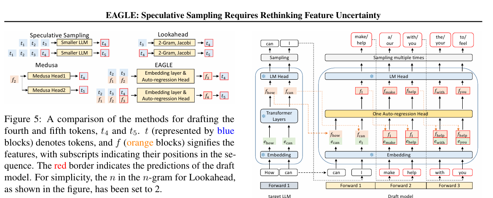
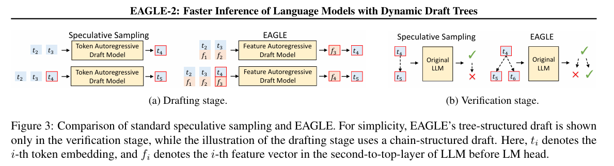
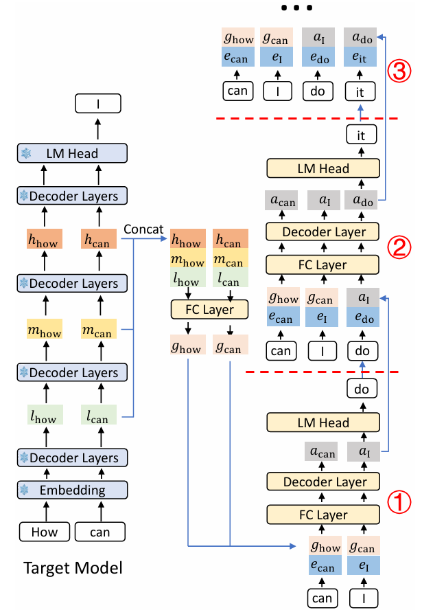

# 投机解码系列：EAGLE-1 到 4 的变化哲学

> **个人理解**：投机解码的胜负手，正在从"让草稿模型猜得更准"转向"让系统决定这一轮到底验多少"。EAGLE-4 的 harness 是这个转向目前最完整的实现——同一份权重、同一台机器，只换树形策略，吞吐就能差 1.5–2 倍。

<sub>2026-10 · 技术理解笔记 · 约 13 分钟 · 基于 EAGLE-1/2/3/4 论文与官方仓库、以及 fal.ai 的三方横评整理</sub>

---

## 一、开篇理解：GPU 在生成文字的时候其实很闲

大模型生成文本分两段：**prefill**（把 prompt 读进去）和 **decode**（一个字一个字往外蹦）。我们日常感受到的"慢"，几乎都发生在 decode。

decode 有个反直觉的特点：**它不是在算，而是在搬。** 每生成 1 个 token，都要把整个模型的权重从显存完整读一遍；可这些权重进了计算单元，做的运算量却很小。结果是 GPU 的算力大量闲置，瓶颈死死卡在**显存带宽**上。

这带来两个后果：

- **单请求快不起来。** 卡再贵也没用，它在等内存，不在等算力。
- **batch 能救吞吐，救不了延迟。** 把很多请求拼成一批可以摊薄权重读取，总吞吐上去了，但每个用户反而更慢。

**投机解码吃的就是这块被浪费掉的算力。**

## 二、投机解码：把主模型"串行猜"换成"并行验"

承接上文：decode 阶段本质上是"用带宽把全部权重搬一遍，却只用算力算一次"，输出多少个 token 就要循环多少遍。搬一次权重只算一次，算力浪费得很彻底。那么有没有办法做到"搬一次、多算几个 token"？如果一次能多算 3 个，输出效率就能提升 2–3 倍。

这就是投机解码的思路，一句话：**先用一个小模型连猜几个 token，再让大模型一次性把它们全验一遍。**

要注意这里"全验一次"的含义：它本质上是**一次前向内并行算多个 token**，把原本空着的算力用起来，而不是真的把大模型跑了 8 遍。所以在中小批量下，"一次前向验 8 个 token"和"一次前向验 1 个 token"的成本几乎一样——反正权重都要读一遍，多验几个几乎是白送的。

那个小模型就是**草稿模型**。它猜对的部分直接被主模型采纳；猜错的第一个位置由大模型自己补一个 token（也叫 bonus），后面的草稿全部截断，然后进入下一轮。于是大小模型交替工作：一个快速猜词，一个一次验证。配合拒绝采样，最终输出的分布与大模型单独解码一致，所以这条路叫**无损加速**。

于是整件事收敛成两个数：

- **接受长度（AL）**：一次验证平均能验对多少 token。越长越好。
- **验证成本**：多验一个候选要多花多少时间。越小越好。

而一个很重要的判断标准是：**加速比就是这两个数在拉锯**——多花一份验证时间，换回来的接受长度值不值。后面所有的分歧，包括 EAGLE-4 最核心的那处设计，都发生在这两个数上。

下面给个示意：

```
无投机解码：6 个 token，6 次前向
  [F1] → t1    [F2] → t2    [F3] → t3
  [F4] → t4    [F5] → t5    [F6] → t6

有投机解码：4 个 token，2 次前向
  [草稿前向]     一次并行猜出 t1 t2 t3 t4
  [target 前向]  一次同时验证 → 接受 t1 t2 t3 + bonus
```

## 三、不同投机解码方式的分岔口：那串候选 token 到底从哪来

所谓「三大将」，就是下面这三条路线。它们共用同一套"猜 → 验 → 接受 → 补 bonus"的骨架，区别只在第一步：

| 路径 | 代表工作 | 草稿怎么产生 | 一次前向产出 | 验证方式 |
|---|---|---|---|---|
| ① 自回归 | EAGLE-1 → 4 | 小 Transformer 逐 token 串行猜 | 1 token / 步，猜 K 层就要 K 步 | 树 |
| ② 并行块扩散 | DFlash / DFlash2 | 一个 block（16）内所有位置一次去噪 | 一整块 | 链 |
| ③ 半自回归 | DSpark | 并行主干 + 低秩 Markov 头补回依赖 | 多 token | 链（长度可变） |

三条路的赌注不同：路径一赌"把每步做便宜、把验证做聪明"；路径二赌"把草稿做宽，让成本不随草稿长度上涨"；路径三赌"两边都要"。

## 四、EAGLE 四代：每一代优化一个核心点

EAGLE 并不是在越改越复杂，而是每代只动一个地方，其余几乎原样继承。

在展开讲解前，先认识一下 EAGLE-1 草稿模型的形态（依据 EAGLE-1 论文与官方仓库配置）。它有四处不太直觉的设计：

- **输入不是"最后一层"，而是"次顶层 + 下一个 token 的嵌入"**
  - 取 target 的 **second-to-top 层**（倒数第二层）hidden state，1 份，形状 `[B, T, H]`
  - 拼接**前进一个时间步**的 token embedding——即"下一个 token 已经知道了"
  - 两者 concat 成 `2H`，再经 `fc = Linear(2H → H, bias=True)` 压回 hidden 维度
  - 这正是 EAGLE 的核心：它不猜"下一个词是什么"，而是猜"已知下一个词时，它的特征应该长什么样"
- **网络只有一层，而且不自带 LM Head**
  - 1 层 `LlamaDecoderLayer`，第 0 层没有 `input_layernorm`
  - 官方 70B draft config：hidden 8192 / 64 heads / 8 kv heads / intermediate 28672 / vocab 32000 / max_pos 4096
  - 输出的是**特征**，要再过**冻结的** `target.lm_head` 才变成 token 分布——drafter 不训练自己的输出头
- **Loss 以特征回归为主，token 项只是辅助**
  - 特征项：`SmoothL1(f_draft, h_target)`，权重 **1.0**
  - token 项：对 target 分布的交叉熵，权重 **0.1**
  - 即 `L = 1.0 · L_feat + 0.1 · L_tok`。保留弱 token 项，是因为最终要的是概率分布，而不只是"特征长得像"
- **验证用树，不是线性验证**
  - 草稿按静态树展开（仓库默认 `depth=7 / top_k=10 / total_token=60`），树表来自 `choices.py`（如 `mc_sim_7b_63`）
  - 给 target 的 attention mask 叠加 `tree_mask`：每个节点只能看到"自己的祖先链 + 自己"，兄弟分支互不可见
  - 一次 target 前向验完整棵树，再由拒绝采样决定接受哪条路径

| 版本 | 核心变化 | 一句话技术解释 | 解决什么问题 |
|---|---|---|---|
| EAGLE-1（2024-01） | 特征级自回归 | 不直接猜 Token，而是自回归预测 Target 的次顶层 Hidden State，再复用 Target LM Head 生成 Token。 | 怎么让草稿模型参与预测 |
| EAGLE-2（2024-06） | 动态候选树 | drafter 权重与 loss 完全不动，把静态树换成上下文感知动态树，根据预测置信度动态决定候选分支，把计算预算分配给更可能被接受的路径。 | 怎么更好利用资源 |
| EAGLE-3（2025-03） | 解耦约束 + 多步训练 | 摆脱 Hidden State 回归约束，融合 3 层 hidden 特征，直接训练 Token 预测（自带 LM head）；训练时模拟多步推理，减少误差累积（training-time test）。 | 怎么让 Draft 猜得更准 |
| EAGLE-4（2026-10） | 硬件感知动态 Draft | 在 Draft 侧引入滑动窗口 4096 tokens 和低秩候选头 rank 128，并根据实际硬件的 Draft / Verify 成本动态调整候选树（硬件感知 harness）。 | 怎么根据实际硬件和负载，决定猜多少、怎么猜才划算 |

几个容易被忽略的细节：

- **EAGLE-1 改变预测方式。** 利用已知的后续 Token 作为条件，预测 Target 主模型对应的未来 Hidden State，实现特征级自回归，尝试降低预测难度。

  

  *图 1：EAGLE 与 Speculative Sampling、Lookahead、Medusa 的草稿方式对比（EAGLE 论文 Figure 5）*

- **EAGLE-2 的收益全部来自预算再分配，不是模型更强。** 官方仓库里 EAGLE-1 和 EAGLE-2 用的是同一份 drafter 代码；区别在于把"全树展开"换成了"挑置信度高的树枝展开"这一工程优化。

  

  *图 2：标准投机采样与 EAGLE 在草稿阶段、验证阶段的对比（EAGLE-2 论文 Figure 3）*

- **EAGLE-3 删去了生成正确 token 的不必要约束。** 前两代被"特征预测"这个约束卡住：既要求新 feature 被正确预测出来，又隐含要求草稿 feature 在忽略数值尺度差异的情况下尽可能接近主模型 hidden state，两者相互掣肘。EAGLE-3 做了解耦，自然消解掉这个不必要约束，并对训练数据做了更精细的分类、融入一部分草稿模型自回归数据——简直天才！

  

  *图 3：EAGLE-3 草稿模型与主模型的特征融合结构*

## 五、EAGLE-4 的两招"省钱"

到 EAGLE-3 为止，优化重点一直是提高接受长度（AL）。但随着 AL 进入 3.5–4.4 的平台区，继续提升的边际收益开始递减。

同时另一笔账开始显眼：**草稿模型自己的开销**。它每步都要跑一次前向，上下文越长、树越宽，这笔钱越贵。于是 EAGLE-4 把优化重心转向成本——工程上的问题变成"如何猜得更便宜"，主要用了两个减少计算的小技巧：

1. **滑窗注意力（4096）**：drafter 的注意力只看最近 4096 个 token，草稿成本从此与上下文长度解耦。每条树分支沿自己的祖先链各自维护窗口，互不混淆。
2. **低秩候选头（rank 128）**：不再每步都算 24 万维的全量 logits。先用 SVD 分解出的小空间（rank=128）粗打分，每个 shard 选 top-128 候选，再只对这些候选走完整 LM head 精算。

**核心变化**：EAGLE-3 追求提高 AL，EAGLE-4 则在维持接受能力的同时，降低每个草稿 token 的生成成本。这两招都不提高 AL——它们只降低"每猜一个 token 的代价"。方向变了。

## 六、真正的核心：Harness 让草稿树具备成本感知能力

前面 EAGLE-1/2/3 的优化重点主要在 Drafter 本身：如何提高预测准确性、增加接受长度（AL）。

但这里需要先澄清一个历史脉络：**动态构建草稿树并不是 EAGLE-4 首创的，EAGLE-2 就已经引入了基于预测置信度的动态构树机制。**

EAGLE-2 解决的是：根据当前上下文中不同候选 token 的预测置信度，决定哪些分支值得扩展。

EAGLE-4 + Harness 则进一步解决另一个问题：

> **即使一个候选分支有较高的接受概率，在当前硬件和负载下，继续扩展它是否仍然划算？**

这意味着，草稿树的构建不再只考虑预测概率，还要考虑实际计算成本。

### 1. 旧世界的困境：预测收益不等于实际收益

以 EAGLE-3 的典型静态配置为例：

- `depth = 7`
- `top_k = 10`
- `total_token = 60`

这些参数通常需要根据特定模型、硬件和测试负载进行调优。问题在于，草稿树的最优形状并不是固定的：

- **Batch=1**：Target 验证可能有较多计算余量，扩大验证树可能带来较高收益。
- **Batch=64**：Target 本身的计算负载已经较高，继续增加验证节点可能带来更大的边际延迟。
- **长上下文**：注意力计算和 KV Cache 开销发生变化，同样规模的验证树可能需要付出更高成本。

这里还要区分 EAGLE-2 和 EAGLE-4：EAGLE-2 已经能够根据 Drafter 的预测置信度动态选择候选分支，但**预测置信度高，不代表验证这些分支的计算成本一定低**。

**EAGLE-4 + Harness 的关键变化，是将预测收益与硬件实测成本放到同一个决策框架中。**

### 2. Harness 的做法：离线标定，在线决策

可以将整个机制理解为三个环节。

#### ① 离线 Profiling：建立成本查找表

Harness 首先需要了解目标推理环境的计算特征。它会在实际部署环境中进行性能标定，测量不同条件下的草稿生成和 Target 验证延迟。主要涉及：

- GPU 型号及硬件特征
- Tensor Parallel（TP）等并行配置
- Target + Drafter 模型组合
- Batch Size
- 上下文长度
- 草稿步数及验证树宽度

最终形成一张成本查找表（Cost Table）。这张表回答的是：

> **在当前硬件、模型和负载条件下，增加一定数量的验证节点，需要额外付出多少计算时间？**

注意，这不是一套针对每种 GPU 人工编写的 if-else 规则，而是基于实际性能测量建立的成本模型。

#### ② 在线构树：同时估算预测收益与计算成本

Drafter 从根节点开始逐层生成候选 token。每增加一层，Harness 都需要考虑两笔账：

- **预测收益**：新增候选分支能够带来多少潜在的接受收益？
- **计算成本**：继续生成这些候选，以及后续验证它们，需要增加多少时间？

其中，预测收益来自 Drafter 的概率信息，计算成本则参考离线标定得到的成本数据。

#### ③ 收益成本比较：决定是否继续扩展

可以用一个简化的投入产出比来理解：

```
R = 预计新增有效接受量 ÷ 新增实测延迟成本
```

Harness 还会结合收益折扣、深度惩罚等策略，对不同层级的扩展进行调整。当收益成本比高于设定阈值时，继续扩展；低于阈值时，则收窄或停止扩展。

因此，最终的草稿树不再完全由预设的 depth、top_k 决定，而是根据当前预测收益与计算成本动态形成。

### 3. Harness 到底适配什么？

这里有一个很重要的工程问题：Harness 究竟要适配 GPU、模型，还是推理引擎？

答案是：**它需要适配完整的推理部署环境，而不是单独适配某一种硬件或模型。**

| 适配维度 | 具体内容 | 影响 |
|---|---|---|
| GPU 硬件 | H100、A100、4090 等 | 计算能力、显存带宽及 Kernel 延迟 |
| 并行配置 | TP 等 | 通信开销、计算分布及验证延迟 |
| 模型组合 | Target + Drafter | 模型前向成本、预测概率及接受表现 |
| 推理引擎 | SGLang、vLLM 等 | 调度机制、Attention Kernel、树验证实现 |
| 运行负载 | Batch、上下文长度、并发量 | 实际计算压力和边际验证成本 |

这里需要特别区分两种适配。

**第一种：模型适配。** Drafter 需要与 Target 的模型结构、隐藏状态及预测机制兼容。更换 Target 模型，通常需要重新训练或适配 Drafter，不能简单地把一套 Drafter 权重直接用于任意模型。

**第二种：系统环境适配。** 同一组兼容的 Target 和 Drafter 权重，可以部署在不同 GPU 和推理引擎上，但需要针对对应环境进行性能标定、Kernel 适配及成本模型构建。

运行时则不需要每来一个请求就重新标定，而是根据当前 Batch、上下文长度等负载信息，查询成本数据并动态调整草稿树。

因此，整个过程可以概括为：**离线 Profiling → 建立 Cost Table → 在线查询 → 动态调整草稿树。**

### 4. 最终意义：从置信度驱动到成本感知

回顾 EAGLE 系列的演进：

| 版本 | 核心优化方向 | 主要解决的问题 |
|---|---|---|
| EAGLE-1 | 特征预测与自回归草稿生成 | 如何训练 Drafter |
| EAGLE-2 | 置信度驱动的动态构树 | 哪些候选分支值得扩展 |
| EAGLE-3 | 训练数据与预测能力优化 | 如何进一步提高接受长度 |
| EAGLE-4 | 低成本草稿生成 + Cost-aware Harness | 在当前环境下，怎样以更低成本获得更多有效 token |

EAGLE-4 的系统价值，不只是让 Drafter 猜得更准，而是让投机解码具备了成本意识：

- 不同 GPU，不必使用相同的固定树形。
- 不同 Batch，不必采用相同的验证预算。
- 同一套兼容的模型权重，可以根据实际负载动态调整预测策略。

> **EAGLE-2 让草稿树学会根据置信度生长；EAGLE-4 + Harness 则让草稿树进一步学会根据计算成本决定是否继续生长。**

这也是投机解码从单纯优化模型预测能力，进一步走向系统级性能优化的重要一步。账面上能看见的收益：

| 对比 | 结果 | 说明 |
|---|---|---|
| Harness ÷ 同权重静态链 | 1.50×–1.98× | 权重完全相同、机器相同，只换"树形由谁定"。这是全套数据里最干净的一组 |
| Harness L=8 → L=16 | 660.1 → 752 tok/s（+13.9%） | 说明这台机器的验证侧还没吃满，多验仍然划算 |
| Harness ÷ 最快对手 | 1.63×（C=1 FW）/ 1.85×（C=1 SpecBench） | 高熵创意负载上优势更大 |

代价也很实：成本表**不可跨机复用**——换 GPU、换 TP、换精度、换引擎版本都必须重新标定；kernels 与 CUDA graph 要按"每个 draft step 一张图、每个验证宽度一张图"准备；首次请求还要热身，因为要现场编译 kernel、实测成本。

## 七、它到底快了多少？

### 1. 官方跨引擎测试

官方 README 在 Qwen3.8-27B、4×B300、temperature=0、SPEED-Bench 条件下，比较 EAGLE-4 与同引擎关闭投机解码的吞吐：

| 引擎 | 1 请求 | 8 并发 | 64 并发 |
|---|---:|---:|---:|
| SGLang | 3.42× | 2.09× | 1.39× |
| vLLM | 2.83× | 1.72× | 1.14× |
| TokenSpeed | 3.09× | 2.02× | 1.41× |

随着并发增加，加速比整体下降。这反映了 Batch 增大后，普通 Decode 本身的 GPU 利用率提高，投机解码能够获得的相对收益随之收窄。

注意：各引擎采用各自的测量配置，这组结果用于观察 EAGLE-4 在不同引擎上的表现，不应直接用来给引擎排名。

### 2. 同机横评：Harness 的优势究竟来自哪里？

fal.ai 与 Fireworks 在 4×B300、TP=4 条件下，对 EAGLE-4 Static Chain、DSpark、DFlash2 和 EAGLE-4 Harness 进行了同机吞吐比较。以下是 Fireworks Bench、L=8 的结果：

| 方法 | C=1（tok/s） | C=8（tok/s） |
|---|---:|---:|
| DSpark | 406.3 | 2621.1 |
| DFlash2 | 389.2 | 2548.0 |
| EAGLE-4 Static Chain | 375.6 | 2382.3 |
| EAGLE-4 Harness | 660.6 | 3566.4 |

在这组测试中，EAGLE-4 Static Chain 的吞吐反而低于 DSpark 和 DFlash2；引入 Harness 后，EAGLE-4 才重新取得领先。

相对最快的对手，Harness 在 Fireworks Bench 上实现了 C=1 的 1.63× 与 C=8 的 1.36× 吞吐；在 Prompt Enhancement SpecBench 上，领先幅度进一步达到 1.85× 和 1.62×。

这组结果最值得关注的不是 EAGLE-4 的 Drafter 有多强，而是 Harness 如何改变验证树的形状与扩展策略。Static Chain 与 Harness 使用同一 EAGLE-4 Drafter 路线，但整体吞吐差距显著。这说明投机解码的性能不仅取决于草稿模型预测得准不准，还取决于系统能否根据实际计算成本，合理分配验证预算。

因此更准确的结论是：**EAGLE-4 的优势来自 Drafter 与成本感知验证策略的协同，而不是单纯依靠更强的草稿模型。**

## 八、另外两条路，为什么值得看？

**DFlash（路径二）** 把草稿生成从逐 Token 自回归，变成一次并行块预测：block=16，一次前向生成整个草稿块。它采用 5 层 Drafter，并将 Target 模型提取的上下文特征注入 Drafter 各层的 K/V，使每一层都能利用 Target 的上下文信息。

它最大的优势是：草稿块长度增加时，不需要逐个 Token 串行执行 Drafter 前向，从而显著降低草稿生成的串行延迟。

但代价也很明显：块内各位置缺乏相互依赖，越靠后的候选位置越容易出现接受率下降，这就是 Suffix Decay。

论文在 Qwen3-4B、temperature=0 的多个任务上取得平均 **4.91×** 加速，相比 EAGLE-3 在多数 benchmark 上实现约 2.5× 的加速提升。NVIDIA 在 8×B300、TensorRT-LLM、gpt-oss-120b 的特定交互延迟区间报告了最高超过 15× 的吞吐提升；Google 在 TPU v5p 的独立 JAX Benchmark 中报告 DFlash 2.29×、EAGLE-3 1.30×。

**DSpark（路径三）** 则是在并行块预测的基础上，重新引入轻量级的 Token 依赖。它主要增加两个模块：

- **Rank-256 Markov Head**：利用前一个 Token，为当前草稿位置增加条件化 Logit Bias，恢复块内 Token 依赖。
- **Confidence Head**：预测各个草稿位置的接受概率，结合引擎吞吐特征动态决定验证前缀长度。

这让 DSpark 不仅能够并行生成草稿，还能判断当前草稿块中有多少 Token 值得交给 Target 验证。在 DeepSeek-V4 的实际生产流量中，论文报告 DSpark 相对 MTP-1，在匹配吞吐水平下将用户生成速度提升了 60%–85%。

有意思的是，两条路线正在从不同方向解决同一个问题：

- **DFlash**：先把草稿并行化，再通过 Markov 头或路径选择器补回块内依赖。
- **EAGLE**：从自回归草稿出发，通过树结构和成本感知调度，扩大有效验证范围。

因此，真正值得研究的问题已经不再是简单的「自回归 vs 扩散」，而是：

> **如何在草稿并行度、块内依赖建模成本和 Target 验证成本之间取得最优平衡？**

这才是下一代投机解码方法竞争的核心。

## 九、望向未来：五个判断

1. **成本模型将从离线标定走向在线自适应。** EAGLE-4 已经展现出两种路径：vLLM 采用离线成本标定，SGLang 则能在服务过程中测量并更新成本。下一步的竞争，是如何让成本模型更及时地感知 Batch、上下文和负载变化，同时避免额外调度开销。

2. **「这一轮该验多少」正在成为公共问题。** EAGLE-4 根据草稿树的预期收益与验证成本决定扩展深度；DSpark 根据位置置信度和硬件吞吐曲线选择验证前缀。两者算法不同，但都在回答同一个问题：当前计算预算应该花在哪些候选 Token 上？

3. **竞争重点将从低并发加速转向高并发稳定性。** EAGLE-4 在单请求下最高达到 3.42×，但并发 64 时 SGLang 的加速比降至 1.39×。官方也针对 SGLang 推出了高负载配方，在特定配置下将性能维持到接近原生 Decode 的水平。未来更重要的指标，不只是单请求有多快，而是高并发下能否持续获得收益。

4. **性能壁垒正在向系统工程转移。** 同一套 EAGLE-4 在 SGLang、vLLM、TokenSpeed 上取得的加速比并不相同。差异不仅来自草稿算法，也来自成本标定、Batch 调度、Kernel、Attention Backend 和 CUDA Graph 等系统实现。算法决定上限，工程决定实际能否达到。

5. **评测口径本身越来越重要。** DFlash2、DSpark 和 EAGLE-4 的公开加速数字，往往来自不同模型、硬件、并发和基线。比如 DSpark 的生产数据是相对自家 MTP-1，而不是相对无投机解码。

看任何加速比，先问三个问题：

- 基线是不是同引擎关闭投机解码？
- 模型、硬件和并发是否一致？
- 报告的是接受长度、单请求延迟，还是端到端吞吐？

没有统一口径，数字就不能直接横向比较。

## 十、一页速查

- **投机解码原理**：自回归 Decode 通常受显存带宽限制，投机解码利用额外计算能力并行验证多个候选 Token；拒绝采样负责保持目标模型的生成分布。
- **三条草稿路线**：EAGLE——自回归草稿树；DFlash——并行块预测；DSpark——并行块预测 + Markov 依赖修正。
- **EAGLE 的演进**：EAGLE-1 建立自回归草稿与验证框架；EAGLE-2 引入置信度驱动的动态树；EAGLE-3 改进草稿模型的特征融合与训练；EAGLE-4 引入成本感知的 Harness。
- **EAGLE-4 模型侧优化**：滑窗注意力 4096、低秩候选头 rank 128，主要降低草稿计算成本，不直接提高接受长度。
- **EAGLE-4 系统侧创新**：Harness 利用成本模型评估草稿树扩展的收益与代价，决定验证树的扩展策略。不同引擎的标定和调度实现并不完全相同。
- **核心实验结论**：同机横评中，EAGLE-4 Static Chain 的吞吐低于 DSpark、DFlash2，而 Harness 明显领先。这说明草稿模型、验证结构与调度策略必须协同优化。
- **最终判断**：投机解码的竞争，正在从「如何生成更好的草稿」，转向「如何以更低的成本，验证更多真正值得接受的 Token」。

### 参考资料

- EAGLE-1：*EAGLE: Speculative Sampling Requires Rethinking Feature Uncertainty*，arXiv:2401.15077
- EAGLE-2：*EAGLE-2: Faster Inference of Language Models with Dynamic Draft Trees*，arXiv:2406.16858
- EAGLE-3：arXiv:2503.01840
- EAGLE-4 官方仓库（含 `docs/architecture.md`、`docs/configuration.md`）：<https://github.com/eagle-hq/EAGLE-4>
- EAGLE-4 技术深评（本文横评数据来源）：*EAGLE-4 Technical Deepdive*，fal.ai，2026-10-20：<https://blog.fal.ai/eagle-4-technical-deepdive/>
- DFlash：*DFlash: Block Diffusion for Flash Speculative Decoding*，arXiv:2602.06036（ICML 2026）
- DSpark：*DSpark: Confidence-Scheduled Speculative Decoding with Semi-Autoregressive Generation*，arXiv:2607.05147（DeepSeek-AI + 北京大学）

> **免责声明**：文中所有加速比均来自各厂商与论文的公开自评，尚无第三方独立复现；跨论文、跨硬件的倍率不可直接相除。
